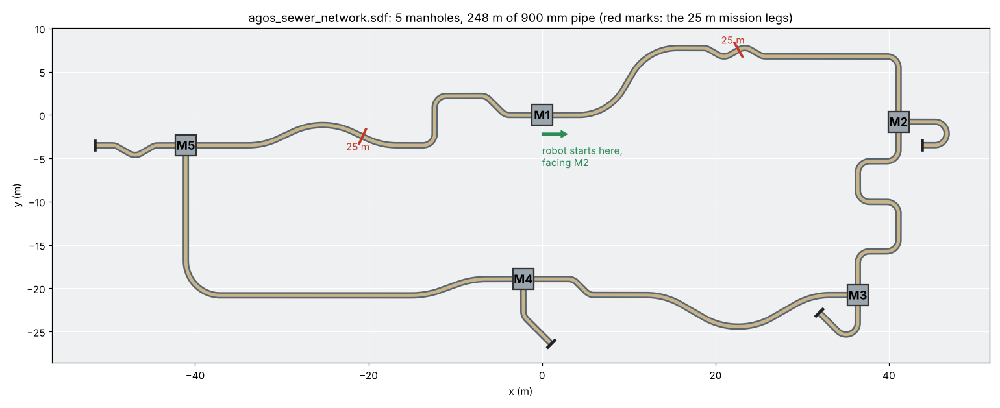
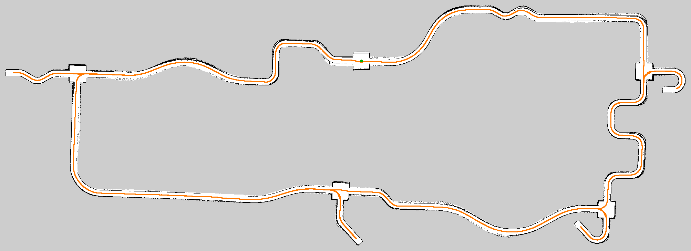

# Bigger network, Fix NAV, exploration, one-command start, speed

This round adds a larger, twistier sewer network as the default world, fixes
the Nav2 problems in the Fix NAV notes, adds the proposal's autonomous
mission (TAD frontier exploration, 25 m each way from the manhole) and a
mode that explores the whole network, replaces the multi-terminal start with
one command (`./agos`) on Ubuntu and in Docker, and makes the whole
simulation lighter.

## Start here

| Where | Start | Autonomous mission | Stop |
|---|---|---|---|
| Windows (Docker in WSL) | double-click `agos.cmd`, or in PowerShell in `practice_agos`: `.\agos start` | `.\agos explore` | `.\agos stop` (or close the window) |
| Ubuntu with ROS 2 installed | `./agos start` | `./agos explore` | `./agos stop` or Ctrl+C |
| Ubuntu or WSL with Docker, no ROS | `./agos start` (uses Docker by itself) | `./agos explore` | `./agos stop` |

`explore` runs the proposal's mission, 25 m each way. To map the whole
network instead, then come back, use `explore full` (section 5).

Everything else:

```bash
./agos explore full    # explore the whole network, then come back to the start
./agos teleop          # drive with the keyboard, in a second terminal
./agos mission         # run the mission in a simulation that is already running
./agos mission full    # the same for the whole network
./agos shell           # a terminal with ROS and the workspace ready (any ros2 command)
./agos check           # what is installed, whether it is built, and whether the GPU is used
./agos build           # build (start and explore do this by themselves when needed)
./agos build --clean   # delete build/ install/ log/ and build again
./agos help            # all of it
# Docker only
./agos reset           # a fresh container (your files and the last map are kept)
./agos image           # rebuild the Docker image after docker/Dockerfile changes
```

Launch options go after the command:

```bash
./agos start gz_gui:=false            # no Gazebo window: much faster, watch in RViz
./agos explore leg_length:=15.0       # explore 15 m each way instead of 25 m
./agos start world:=agos_sewer.sdf    # the smaller sewer from the last round
./agos start localization:=true       # reuse the last map instead of making a new one
./agos start rtabmap_viz:=true        # also open RTAB-Map's own window (heavy)
./agos start camera_width:=640 camera_height:=480 camera_rate:=15   # the old, sharper camera
```

Once, after copying this folder in:

- **Docker users:** run `./agos reset` (or `.\agos reset`) once. It makes the
  new container with its home folder on a Docker volume, which is faster and
  keeps RTAB-Map's map when the container is reset.
- **Git users:** the repository still tracks `build/`, `install/` and `log/`
  from another computer (links to `/home/reuel/...`), which break builds on
  every other machine. Untrack them once, and keep `agos` executable:

  ```bash
  git rm -r --cached practice_agos/build practice_agos/install practice_agos/log
  git update-index --chmod=+x practice_agos/agos
  ```

  The new `.gitignore` keeps them out from then on, and `.gitattributes` keeps
  Unix line endings in `agos` and the scripts when Git runs on Windows.

## What changed, by request

| # | Request | What changed | Files |
|---|---|---|---|
| 1 | Bigger map with twisting routes, as a new default file | New 5-manhole, 248 m network with S-bends, a zig-zag, a serpentine, doglegs and four dead ends. The old worlds are kept. | `worlds/agos_sewer_network.sdf`, `meshes/agos_network_*`, `tools/make_pipe_mesh.py`, `launch/sim.launch.py`, `docs/agos_network_overview.png` |
| 2 | Fix NAV.pdf | Nav2 starts by itself once RTAB-Map's map exists, with exactly the nodes that run; the velocity chain reaches Gazebo with no relay; the Navigation 2 panel is in RViz. Checked by driving missions. | `launch/slam_nav.launch.py`, `agos_sim/nav_supervisor.py`, `rviz/agos.rviz`, `config/nav2_agos.yaml` |
| 3 | Colour from the STL | Already done in the STL round: the six CAD colours are on the robot in Gazebo and RViz. Nothing to add. | `urdf/agos_materials.xacro` |
| 4 | Simpler start, Ubuntu and Docker | One script, `agos`, for both, plus `agos.cmd` for Windows. | `agos`, `agos.cmd`, `docker/Dockerfile`, `docker/agos.sh` |
| 5 | Autonomous exploration and navigation from the proposal | The two-leg mission with TAD frontier selection, a report at the end. | `agos_sim/explorer.py`, `agos_sim/frontiers.py`, `launch/agos.launch.py`, `test/test_frontiers.py` |
| 5+ | Full map exploration, besides the proposal's 25 m each way | `./agos explore full`: every pipe and dead end of the network, chosen with the same TAD scores, then back to the start manhole. | `agos_sim/explorer.py`, `agos_sim/frontiers.py`, `launch/agos.launch.py`, `launch/slam_nav.launch.py`, `agos`, `test/test_explorer.py`, `test/test_frontiers.py` |
| 6 | Other issues | The robot could get stuck crossing a manhole off-centre; RTAB-Map rotated the map in pipes, rejected loop closures, and once joined two places 33 m apart; build, stop and RViz problems; see section 6. | `urdf/agos_tracks.xacro`, `urdf/agos_urdf.xacro`, `tools/make_pipe_mesh.py`, `meshes/agos_*_chambers.*`, `launch/slam_nav.launch.py`, `agos_sim/odom_gps.py`, `agos`, `rviz/agos.rviz` |
| + | Speed | Lighter physics, camera, meshes, Nav2, RViz; the Python nodes off `/clock`; see section 7. | several |

## 1. The network (default world)



`worlds/agos_sewer_network.sdf`: five manholes (M1 to M5) joined in a loop by
900 mm pipe, 247.6 m in all, in 9 runs:

| Run | Length | Shape |
|---|---|---|
| M1 to M2 | 49.5 m | a sweeping S-curve (6 m radius), a zig-zag of 30 and 60 deg bends, a long straight, 90 deg into M2 |
| M2 to M3 | 28.2 m | a serpentine of six 90 deg bends |
| M3 to M4 | 38.4 m | long sweeping curves (8 m radius), then a dogleg |
| M4 to M5 | 52.4 m | a gentle S (10 m radius), a long straight, a wide 90 deg bend |
| M1 to M5 | 44.8 m | a dogleg, a step (90 left, 90 right), a gentle wiggle |
| 4 dead ends | 8.7, 8.2, 7.6, 9.8 m | a hairpin (M2), a 135 deg bend (M3), a 45 deg bend (M4), a zig-zag (M5), capped |

The robot starts in M1 facing M2, with 49.5 m of pipe ahead and 44.8 m
behind, so the proposal's 25 m each way fits without reaching the next
manhole. Pipes only meet in manholes. In front of each pipe the manhole floor
is shaped like the pipe (benching and a shallow channel), so a robot that
reverses out of a pipe off-centre meets a ramp instead of a step. The
benching is 8 cm high, under the robot's belly: at 20 cm it caught the belly
of a robot crossing a manhole off-centre (section 6).

The other worlds are still there: `agos_sewer.sdf` (the smaller sewer, last
round's default), `agos_pipe.sdf` (the CAD pipe) and `agos_world.sdf` (the
first test room). To change the network, edit `network_layout()` in
`tools/make_pipe_mesh.py` and run
`python3 agos_sim/tools/make_pipe_mesh.py --layout network`.

## 2. The Fix NAV notes, problem by problem

| In the notes | Why it happened | Now |
|---|---|---|
| Source ROS in every terminal; one terminal for `sim.launch.py`, another for `slam_nav.launch.py use_sim_time:=True autostart:=True` | Two launch files, nothing to source them | `./agos start` sources ROS and the workspace, builds if needed and starts everything (`agos.launch.py`). `./agos shell` gives an extra terminal that is ready to use. The two launch files still work on their own. |
| Add the Navigation 2 panel by hand | Not in the RViz config | It is in `agos.rviz` (left, under Displays), with the Nav2 Goal tool. |
| `lifecycle_manager` missing from `ros2 node list`; started by hand with a node list, then `manage_nodes {command: 0}`, and "do not close this CLI tab" | `navigation_launch.py` started Nav2 straight away. Its costmaps waited for RTAB-Map's `map -> odom` transform, timed out, and the whole bring-up was aborted. Its node list also had nodes that this setup does not run. | `slam_nav.launch.py` starts the Nav2 servers and `lifecycle_manager_navigation` itself, with exactly the nodes that run. `nav_supervisor` waits until RTAB-Map publishes the map, then starts Nav2 (the same `manage_nodes` call), checks every 5 s that it is still active, and restarts it if not. Nothing to type; the panel shows Navigation: active. |
| Switch RTAB-Map to localization in its window | Mapping always started a new map | `./agos start localization:=true` loads the last map and only localizes. RTAB-Map's window is off by default to save CPU (`rtabmap_viz:=true` opens it). The red and blue rings are the costmaps, shown as Global Costmap and Local Costmap in RViz. |
| 2D Pose Estimate gives a "localization" warning while mapping | RTAB-Map ignores pose estimates while it makes a map | Expected. In mapping mode the robot's position comes from the map itself; use 2D Pose Estimate with `localization:=true`. |
| Green path but the robot does not move; `/cmd_vel_nav` has data, `/cmd_vel` does not; `topic_tools relay /cmd_vel_nav /cmd_vel` works, remapping in `slam_nav.launch.py` did not | `navigation_launch.py` sends velocity_smoother's output through `collision_monitor` before `/cmd_vel`. When `collision_monitor` was not active, nothing reached `/cmd_vel`. A remap around the included launch file does not reach the nodes inside it. | Fixed route, no relay: `controller_server` and `behavior_server` publish `/cmd_vel_nav`, `velocity_smoother` turns it into `/cmd_vel`, the bridge passes it to Gazebo. `collision_monitor` is left out; the costmaps keep the robot off the walls. |

How this was checked: Nav2 started itself in every run below, the explorer
drove the robot through Nav2 (the same NavigateToPose action RViz's Nav2 Goal
uses), and stopping Nav2 on purpose made `nav_supervisor` restart it within
10 s.

## 3. Colour

The robot already has the colours of the CAD model (STL round, see
`STL_INTEGRATION.md`): grey body, green panels, red treads, yellow accents,
light grey parts and black sensors, one mesh per colour. They show in Gazebo
(`docs/agos_gazebo_front.png`) and RViz. Nothing changed here.

## 4. One command to start: `agos`

`agos` (and `agos.cmd` on Windows, which runs it in WSL) does what the
terminals in the notes did by hand:

1. **Where to run.** If ROS 2 is installed (`/opt/ros/<distro>`), it runs
   right there. If not, and Docker is, it runs inside a container called
   `agos`. `AGOS_DOCKER=1 ./agos ...` forces Docker, `AGOS_DOCKER=0` forces the
   local install.
2. **Docker.** The first time, it builds the image from `docker/Dockerfile`
   (10 to 30 minutes), then makes the container once and reuses it, so later
   starts take seconds. This folder is `/ws` inside it, so files you edit
   outside are the files it runs. The home folder (`~/.ros`: logs and
   RTAB-Map's map) is on a Docker volume, which is faster than a Windows
   folder and survives `./agos reset`. It passes in the GPU (`/dev/dxg` on
   WSL, `/dev/dri` on Linux) and the display. A container made for another
   copy of `practice_agos` is refused with a message to run `./agos reset`.
3. **Build.** It builds `agos_sim` when the sources changed since the last
   build, or when the last build was made with another ROS or Python (for
   example outside Docker and then inside it). A build that fails over an
   old `build/` and `install/` (such as the ones from another computer in the
   repository) is retried once from clean.
4. **Start.** It sources ROS and the workspace, checks the graphics, and runs
   `ros2 launch agos_sim agos.launch.py` with your options. If a simulation is
   still running (an earlier start, or a closed window) it stops it first.
5. **Stop.** `./agos stop` sends Ctrl+C to the launch and Gazebo, waits for
   RTAB-Map to save its map, then ends anything left. Gazebo's server could
   outlive a Ctrl+C of the launch before; this catches it.

`docker/agos.sh` from the last round still works and now just calls
`./agos shell`.

## 5. Autonomous exploration and the mission

`./agos explore` runs the proposal's flow of operation from the manhole the
robot starts in:

1. explore up to 25 m along the pipe it is facing,
2. reverse back to the start (it cannot turn in a 900 mm pipe),
3. turn round in the manhole (Nav2's spin),
4. explore up to 25 m along the pipe on the other side,
5. reverse back to the start,
6. write a report.

**Frontier selection (TAD).** A frontier is the edge between mapped free space
and unmapped space in RTAB-Map's `/map`. Each frontier in the current leg gets
the score from Buriboev, Choi and Jeon (2025), with equal weights:

    F = d + a + t
    d  path distance from the robot, scaled up by how much of the area around
       the frontier is still unexplored: d x (1 + A_unexplored / A_total)
    a  1 + the number of frontiers next to it
    t  +1 if the gap opens out into unknown space, 0 if the same width, -1 if it narrows

The robot drives to the highest-scoring frontier with Nav2, keeps that goal
until it gets there or the frontier is mapped, and goes on to the next. A
frontier counts for a leg if it is reached through the pipe in that leg's
direction (or, near the start, lies in that direction) and is no further
than `leg_length` along the pipe. Frontiers that Nav2 could not reach, ones
already reached, and gaps in the walls of pipe already driven through are
skipped. When nothing is left, the robot drives to the far end of what it
mapped in the leg, so the camera has seen all of it, then goes back.

**In RViz:** the Explorer display shows the frontiers (green: in this leg,
grey: not), each one's F, the current goal (yellow sphere), the leg
directions (blue arrows) and the path driven (orange).
`ros2 topic echo /explore/status` says what it is doing.

**Report:** `missions/<date_time>/` in this folder: `report.md` (result,
time, distance, area mapped, a table per leg, every event), `map.png` (the map
with the path and goals), `map.pgm` and `map.yaml` (the map for
`nav2_map_server`) and `trajectory.csv`.

**Control:** `ros2 service call /explore/stop std_srvs/srv/Trigger` stops and
writes the report; `/explore/start` starts again. Parameters (with
`./agos mission --ros-args -p name:=value`, or in `agos.launch.py`):
`leg_length` (25.0), `legs` ([0.0, 180.0], degrees from the start heading),
`turn_around` (true), `stuck_timeout` (40 s), `autostart` (true).

**Results here** (map position compared with Gazebo's true position):

| Run | Legs | Result | Driven | Map error |
|---|---|---|---|---|
| Mission, 25 m legs, with the final code | both explored to 25 m | completed, 338 s | 97.6 m | 0.03 m back at the start (largest: 0.38 m at the far end of leg 1) |
| Fresh copy, `./agos explore leg_length:=12.0` | both explored to 12 m | completed, 166 s | 46.6 m | 0.03 m back at the start (largest 0.10 m) |

### The whole network: `./agos explore full`

`./agos explore full` maps every pipe the robot can reach, dead ends
included, then drives back to the manhole it started in and writes the
report. The same thing in `agos.launch.py` is `explore_mode:=full`, and in a
simulation that is already running, `./agos mission full`. The 25 m mission
above is still the default.

First it turns once round in the start manhole (`look_round`). The camera
only looks ahead, and RTAB-Map recognises a place by what the camera sees: in
a test run the robot came back through the start in reverse, facing the
other way, RTAB-Map did not know the place, and the map stayed 4 m off.

It uses the same frontiers and the same TAD score, but the whole map at once
needs more than "the highest F": a far frontier that scores higher would send
the robot back and forth between the two ends of the loop. So:

1. **Nearest pipe first.** It picks the highest F only among the frontiers
   no more than `reach` (2 m) further along the pipes than the nearest one.
2. **It keeps to the pipe it is in.** The goal moves on with the end of the
   mapped pipe, so the robot drives through to the next manhole instead of
   switching to another frontier halfway. At the start it takes the pipe it
   is facing, and the pipe behind waits. If its goal goes from the map (the
   end of a pipe at a bend can, until the robot sees round the bend), it
   drives on towards it for up to 8 s before it chooses again; choosing
   again at once sent it back and forth between a bend and a frontier 58 m
   behind. It leaves its goal for later only for a frontier that has come
   up at least 24 m (twice `peek`) nearer along the pipes and is still there
   a second later, which happens when RTAB-Map redraws the map round the
   robot after it chose.
3. **The other pipes of a manhole.** Driving through a manhole, it remembers
   the pipes it did not take. Once it is `peek` (12 m) past the manhole and
   its own pipe goes on, it goes back once for them (they are often short
   dead ends), then goes on with the nearest frontier, usually where it left
   off. It maps the pipe it went back for before it goes back again for
   anything. Without this it came back for the dead ends only after the
   whole loop: 511 m instead of 305 m in the offline check below.
4. **Long drives go in steps.** Nav2's global costmap is a 50 x 50 m window
   round the robot, so it cannot plan to a goal more than 25 m away. A drive
   longer than `hop_length` (8 m) goes in steps along the explorer's own route
   through the mapped pipes, which also keeps Nav2 from cutting through
   unmapped space. The next step is sent before the robot reaches the last
   one, so it does not stop on the way.
5. **Where it has been.** As in the 25 m mission, it skips frontiers next to
   the path it drove (gaps that open in the walls of mapped pipe), but here
   the path comes from RTAB-Map's map nodes (`/mapPath`), so when a loop
   closure moves the map, the path moves with it. That path also counts as
   passable for its routes, whatever the map shows there now: after a long
   drive RTAB-Map can draw a wall twice, a little apart, and a pipe the robot
   has just driven through then looks too narrow on the map. (RTAB-Map now
   keeps that path free on the map too, for Nav2: `GridGlobal/FootprintRadius`,
   see `RTABMAP_FIXES.md`.) Frontiers up to 2.5 m beside the path are mostly
   gaps in such doubled walls, so it does not go to them, except for the end
   of a pipe it left for later; the report lists them. Without this, a loop
   that RTAB-Map had not closed sent it round the network again.
6. **The end.** When no frontier is left, it tries the ones Nav2 could not
   reach once more, then goes back to the start along the mapped pipes.

**In RViz:** the yellow sphere is where it is going and the small orange one
the step it is on; the frontiers, their F and the path are shown as before.

**Report:** the same `missions/<date_time>/` files, with one line for the
frontier goals instead of the table per leg, and the frontiers left at the
end with why each one was left: not explored, could not be reached, reached
but nothing more could be mapped from there, next to the path driven (item
5), or a gap in the wall of a pipe already driven through. In `map.png` the
first three kinds are red dots, and the path is RTAB-Map's own, which loop
closures move with the map; `trajectory.csv` has where the robot was on
the map at the time.

**Parameters** (as above): `reach` (2.0 m), `peek` (12.0 m), `hop_length`
(8.0 m), `look_round` (true), `map_path_topic` (`/mapPath`), and
`stuck_timeout`, `autostart`;
`leg_length`, `legs` and `turn_around` are not used.

**Against the proposal.** The proposal limits one insertion to halfway
between access shafts (scope, item 10; 30 m in the limitations), on a tether
that carries power and Ethernet. A real AGOS could not drive round this 248 m
loop on its tether, so this mode is for the simulation: mapping the whole
network, testing RTAB-Map's loop closures, and trying longer runs than the
proposal's.

**Results:**

On the 4-core test computer without a GPU, where Gazebo ran at about 0.3
times real time:

- **Offline check.** The explorer's choices (`WholeMap` and the frontiers in
  `frontiers.py`) ran on a map of the true network, drawn from the layout in
  `tools/make_pipe_mesh.py`, with a point robot and a 10 m LiDAR. It mapped
  all 9 runs of pipe to their ends, the dead ends included, with 125
  frontier goals and 301 m of driving, then 4 m back to the start: 305 m.
  This checks the choices only, not the driving or RTAB-Map.
- **In the simulation** (`./agos explore full gz_gui:=false rviz:=false`):
  completed. The robot mapped every pipe and dead end and came back to the
  start manhole after 401 m, in 1409 s of simulation time (83 minutes
  here). Coming into the start manhole, RTAB-Map recognised it and closed
  the loop: the robot's position on the map went from 3.9 m off to 0.02 m.
  By then the odometry was 7.3 m off (1.8% of the distance driven), and the
  EKF's heading had stayed within 0.6 deg.
- **The map at the end is not right everywhere.** The loop closure moved
  the whole map, but compared with the true pipes, RTAB-Map's final path
  is within 0.6 m of the pipes' centre lines over half its length and up
  to 2 m off round M5, on the far side of the loop. The robot drives round
  the loop once, so the start is the only place where the loop closes.



Five earlier runs found the problems in section 6 (the robot stuck in a
manhole, RTAB-Map turning the map, rejecting every loop closure, and
joining places 33 m apart). The runs after them:

| Run | Result | Driven | What went wrong | Changed |
|---|---|---|---|---|
| 6 | "completed", but 18 m from the start | 403 m | RTAB-Map undid the right loop closures at the start by a hair, then took a pipe 18 m away for the start | `RGBD/OptimizeMaxError` 5, a 12 m radius |
| 7 | could not get back to the start | 356 m | It came back through the start in reverse; RTAB-Map did not know the place, and the map stayed 3.9 m off | `look_round` |
| 8 | stopped by hand | 510 m | A speck on the map closed the pipe to M5, then the robot rocked back and forth for 10 minutes | Specks count as free; stuck means no headway |
| 9 | stopped by hand | 243 m | The first headway check took a moving robot for stuck | Headway counted from where it last made some |
| 10 | completed | 401 m | | (above) |

**Limits.** The odometry drifts about 1.8% of the distance driven, and
RTAB-Map corrects the map only where the robot comes back to a place it
has seen facing the same way, because the camera only looks ahead. Back
in a pipe facing the other way, RTAB-Map can draw the pipe a second time,
a little apart. On a long drive back through such pipes Nav2 may find no
way through; the explorer then stops with "could not get back to the
start" instead of trying forever. RTAB-Map also looks for loop
closures only within 12 m of where the odometry puts the robot: at 1.8%,
that is about 650 m of driving without a loop closure (worked out, not
tried), so a network much bigger than this one may need a larger
`RGBD/LocalRadius`.

## 6. Other problems found and fixed

- **The robot stuck in a manhole.** In a whole-network run the robot crossed
  M4 0.45 m off the line of its pipes and stopped there. Its tracks kept
  turning, so the odometry counted 6 m, but it did not move. The explorer's
  stuck check did not notice: it watches the robot's position on the map,
  which follows the odometry. Tracks slipping in place would still go
  unnoticed, and the robot would keep trying until stopped. Driving it in
  Gazebo showed two causes. The 20 cm benching beside each opening caught
  its belly, which is 78 mm off the ground; the benching is 8 cm now
  (`tools/make_pipe_mesh.py` and the chamber meshes). And of the four road
  wheels on each side only the middle two gripped: the outer two slid both
  ways so that the robot could skid-steer. Where the floor curved up under
  one track, the middle wheels lifted off and the outer ones could not push,
  so the robot stalled 0.2 m off the middle. Now every road wheel grips
  along the track and the outer ones slide only sideways
  (`agos_tracks.xacro`). Driven at M4's openings from 0.2 m off the middle,
  forwards and in reverse, the robot now goes into the pipe; from 0.42 m off
  it stops at the wall, where it is too wide for the opening. It also turns
  as fast as commanded now without a correction, so `skid_factor` is 1.0 (it
  was 1.30, `agos_urdf.xacro`).
- **RTAB-Map turned the map in pipes.** LiDAR scan matching between
  neighbouring map nodes cannot tell how far the robot moved along a round
  pipe, and it rotated the map 6.5 deg in a test mission while the gyro
  heading was right to 0.1 deg; the robot then could not find its way home.
  That matching is off now (`RGBD/NeighborLinkRefining`,
  `RGBD/ProximityBySpace`), and loop closures correct the drift.
- **RTAB-Map rejected every loop closure.** It took odometry from `/odom`,
  where the EKF reports a variance of 1e-9, so it trusted the odometry
  completely ("Rejecting all added loop closures"). It now takes the
  `odom -> base_footprint` transform with a realistic uncertainty (1.4 cm
  and 0.4 deg per step). See `RTABMAP_FIXES.md`, section 4.
- **RTAB-Map joined places that only looked alike.** Every pipe in the
  simulation has the same concrete texture and every manhole looks the same.
  Late in a whole-network run RTAB-Map took one pipe for another 33 m away (a
  loop closure that passed all its checks), the map turned 100 deg, and the
  robot could not find its way back. A new node, `odom_gps`, now gives
  RTAB-Map the robot's odometry as if it were a GPS fix, and RTAB-Map only
  looks for loop closures with places within 12 m of where the odometry says
  the robot is (`Rtabmap/LoopGPS`, `RGBD/LocalRadius`). In the next run, back
  at the start after 400 m, RTAB-Map undid every right loop closure there by
  a hair: its check lets a closure stretch the map's links 3 standard
  deviations, and they stretched 3.0001 to 3.0005. The map stayed 9 m off,
  and RTAB-Map then took a pipe 18 m away for the start. The check allows 5
  now (`RGBD/OptimizeMaxError`); replayed with these settings, that run's map
  data closes the loop, and every closure in it is right. RTAB-Map also uses
  PCL's ICP now in every install (`Icp/Strategy` 0), the one all the tests
  here ran with. See `RTABMAP_FIXES.md`, section 4.
- **The heading in bends.** The EKF adds up the gyro's z rate as the
  robot's heading. Tilted on a pipe wall, the gyro's z axis is not vertical
  and measures only part of a turn: through one bend, tilted up to 12 deg, an
  88 deg turn came out 0.6 deg short. Out and back that cancels; round a loop
  it adds up. A new node, `imu_level`, now gives the EKF the heading's own
  rate of turn, from the gyro and the IMU's roll and pitch (`/imu/level`).
  In the last whole-network run (401 m) the EKF's heading stayed within
  0.6 deg of the truth, while the gyro's z rate alone drifted 5.7 deg.
- **A speck on the map closed a pipe.** In a whole-network run the robot
  turned back 3 m short of a pipe that went on for 20 m. One 5 cm cell in
  the middle of the pipe was marked as wall, most likely where the LiDAR's
  scan, tilted with the robot, met the bottom of the pipe ahead. The
  explorer keeps the robot's centre 0.2 m from walls, so beyond that cell
  the pipe looked closed and its end could not be reached. One or two wall
  cells with no unknown space round them now count as free for the
  explorer (`frontiers.py`, `Grid`); Nav2, on its finer map, has room to
  pass one. On the long drive back that followed, the robot rocked 3 m back
  and forth for 10 minutes where its map showed the pipe twice, because the
  stuck check counted any 0.3 m of movement as progress. Stuck now means
  40 s (`stuck_timeout`) without 0.3 m of headway towards the goal,
  measured from where the robot last made some, so driving back and forth
  does not count (`test/test_explorer.py`).
- **RViz crashed on opening with the Navigation 2 panel** (in a test on a
  virtual display), because the saved window layout did not include the
  panel. The layout is saved with it now, in a 1280 x 800 window.
- **Explorer:** a crash when a log message changed level; the robot going
  back for gaps in walls it had already passed; a frontier just inside the
  pipe behind the start counting for both legs; a Nav2 check that could hang
  forever; headings shown as "360 deg" or "-0 deg" in the report. A goal
  that Nav2 drops only because RTAB-Map's `map -> odom` transform came late
  ("Unable to transform goal pose into costmap frame"; on this 4-core test
  computer it was up to 1.7 s late, a few times in a long run) is sent again
  a second later, for up to 15 s, instead of being given up as unreachable.
  A goal Nav2 refuses with "Start occupied" (its map shows the robot inside
  a wall) is sent again after backing up 0.25 m. After it gets to a
  frontier it waits 2 s for RTAB-Map to add what the LiDAR sees from there
  before it chooses again, and a "reached" from Nav2 with the robot more
  than 0.6 m from the goal (once 1.2 m, as a loop closure moved the map) is
  not counted. A mission stopped with Ctrl+C or `./agos stop` still writes
  its report, and no longer prints a traceback and "publisher's context is
  invalid" errors after it. The report's distance driven counted the
  robot's jumps on the map at loop closures (4 m at the end of a
  whole-network run); it is added up on the odometry now. A path past the
  edge of the map drew an orange line across the whole of `map.png`.
- **Build:** the committed `build/` and `install/` from another computer make
  `colcon build` fail with "can't open file .../build/agos_sim/setup.py"; see
  section 4, point 3.
- **Package:** `package.xml` lists the Nav2, RTAB-Map and Python packages the
  launch files use, so `rosdep` and `./agos check` know them; lint (flake8,
  pep257) is clean and `test/test_explorer.py`, `test/test_frontiers.py`
  and `test/test_imu_level.py` have 33 tests.

## 7. Speed

| Change | Effect |
|---|---|
| `gz_gui:=false` (option) | No Gazebo window: the biggest single saving, above all without a GPU. Watch in RViz. |
| Physics step 2 ms instead of 1 ms (network world) | Half the physics work; `/clock` 500 instead of 1000 messages a second. The tracks drive the same on every bend. |
| No shadows (network world) | Less rendering for every camera, the Gazebo window included. |
| Camera 320 x 240 at 10 Hz instead of 640 x 480 at 15 Hz | 6x less image data for rendering, the bridge and RTAB-Map; RTAB-Map still finds enough features. Options bring the old camera back. |
| Depth point cloud only on demand | Bridged lazily and off in RViz; nothing uses it unless you tick Depth PointCloud. |
| Joint states at 20 Hz | Was every physics step: 12 wheel transforms on `/tf` 500 times a second. Measured 16 Hz on Jetty (20 Hz times the real-time factor). |
| Lighter pipe meshes | Collision: only the bore, 32 facets round. Visual: fewer rings on straights. About a quarter of the old file sizes. |
| RTAB-Map's window off by default; smaller queues | It drew the whole 3D cloud map again; RViz already shows the map. |
| Nav2 lighter | Controller at 10 Hz, MPPI with 1000 samples of 3 s, a 2D obstacle layer instead of the 3D voxel layer, costmap updates instead of full maps. |
| RViz at 15 frames a second | Was 30. |
| Explorer and `nav_supervisor` off `/clock` | A Python node following `/clock` used 13% of a CPU core here doing nothing. Measured: explorer 23% to 6%, `nav_supervisor` 16% to 0.2%. The explorer takes simulation time from `/tf`, so its report still counts simulation seconds. |

If it is still slow:

1. `./agos check` shows `Graphics:`. "llvmpipe" means no GPU: Gazebo, RViz and
   the camera are drawn by the CPU. On Windows (WSL) `agos` uses Mesa's D3D12
   driver whenever a test shows it reaches the GPU, whatever the GPU: Mesa 26
   in the Lyrical image chose llvmpipe by itself on a PC with an NVIDIA card.
   If it still says llvmpipe, update the graphics driver and run
   `wsl --update` in PowerShell, then `./agos reset`.
2. `./agos start gz_gui:=false`.
3. `camera_rate:=5` halves the camera work again.
4. Docker on a Windows laptop with two GPUs can draw on the weaker one.
   `MESA_D3D12_DEFAULT_ADAPTER_NAME=NVIDIA ./agos reset` (or `AMD`, `Intel`)
   makes a container that uses the named one. If Gazebo crashes on the GPU,
   `LIBGL_ALWAYS_SOFTWARE=1 ./agos reset` makes one that draws on the CPU.
   The container keeps the setting until a plain `./agos reset`.

Harmless lines in the terminal:

- `planner_server: Inflation layer either not found or inflation is not set
  sufficiently...`: Nav2's 2D Smac planner always prints it; it plans for a
  round robot and does not use that check.
- `ekf_filter_node: Failed to meet update rate!` now and then: the computer was
  busy for a moment.
- `LifecycleNode is not shut down` and Gazebo "escalating to SIGTERM" when
  stopping.
- `RuntimeWarning: coroutine 'Executor._make_handler.<locals>.handler' was
  never awaited` from the explorer now and then when it is stopped: rclpy
  stopped before running a callback it had lined up.

## 8. What was tested, and what was not

Tested here (4 CPU cores, no GPU):

- **ROS 2 Kilted with Gazebo Ionic** and RTAB-Map 0.23.13: the full stack,
  the missions above, `./agos build`, `start`, `explore`, `stop` and `check`,
  Nav2 restarting after being stopped, RViz with this config on a virtual
  display (screenshot checked: panel, map, camera, explorer markers).
  RTAB-Map was built here from source with GTSAM, the graph optimizer the
  ROS packages use, and with PCL's ICP, which the launch file now selects
  for every install (section 6).
- **Docker with the ROS 2 Lyrical base image** (Gazebo Jetty 10.5,
  Python 3.14): `./agos check`, `build`, `stop`, `reset` and the
  wrong-folder check; the network world, the robot, the bridge, the sensor
  topics and their frames, and the 20 Hz joint states.
- **Gazebo Jetty**: the robot driven through every bend of the network.

Not tested: Nav2 and RTAB-Map on Lyrical (their packages could not be
downloaded here), `agos.cmd` and the windows on Windows (WSLg), and the GPU
passthrough. If something fails there, `./agos check` and the first error
in the terminal are the most useful things to send.

## Files

New: `agos`, `agos.cmd`, `.gitattributes`, `.gitignore`,
`NETWORK_NAV_EXPLORE.md`, `agos_sim/launch/agos.launch.py`,
`agos_sim/agos_sim/explorer.py`, `agos_sim/agos_sim/frontiers.py`,
`agos_sim/agos_sim/nav_supervisor.py`, `agos_sim/agos_sim/odom_gps.py`,
`agos_sim/agos_sim/imu_level.py`, `agos_sim/test/test_explorer.py`,
`agos_sim/test/test_frontiers.py`, `agos_sim/test/test_imu_level.py`,
`agos_sim/test/data/`, `agos_sim/worlds/agos_sewer_network.sdf`,
`agos_sim/meshes/agos_network_*`, `docs/agos_network_overview.png`,
`docs/agos_explore_full_map.png`.

Changed: `agos_sim/launch/sim.launch.py`, `agos_sim/launch/slam_nav.launch.py`,
`agos_sim/config/nav2_agos.yaml`, `agos_sim/config/bridge.yaml`,
`agos_sim/config/ekf.yaml`,
`agos_sim/rviz/agos.rviz`, `agos_sim/urdf/agos_urdf.xacro`,
`agos_sim/urdf/agos_sensors.xacro`, `agos_sim/urdf/agos_tracks.xacro`,
`agos_sim/tools/*.py`, `agos_sim/meshes/agos_pipe.*` and `agos_sewer_*`
(regenerated, lighter), `agos_sim/package.xml`, `agos_sim/setup.py`,
`docker/Dockerfile`, `docker/agos.sh`, `RTABMAP_FIXES.md`, `PIPES_AND_NAV2.md`
(a note on the skid factor).
