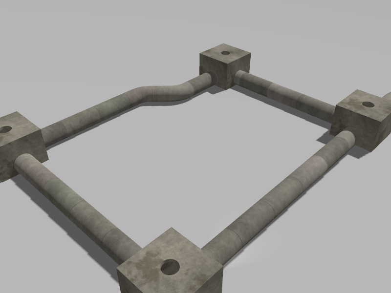
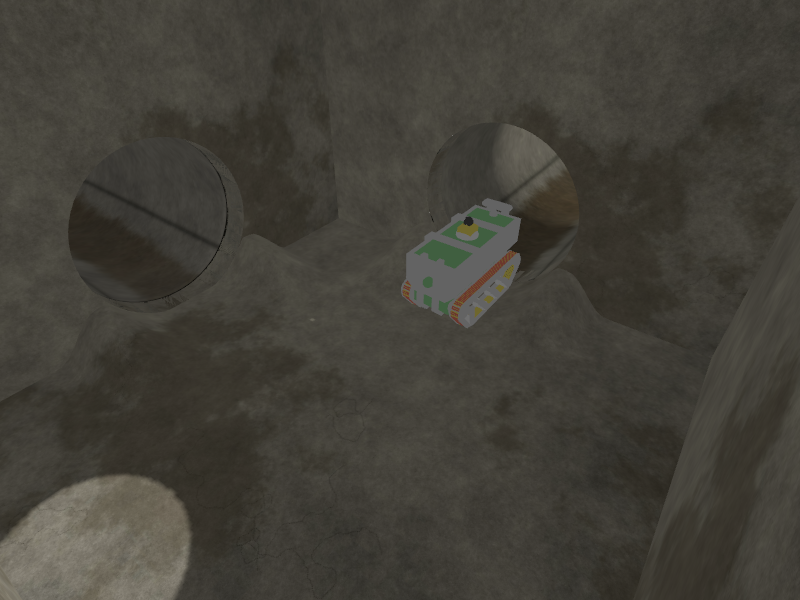
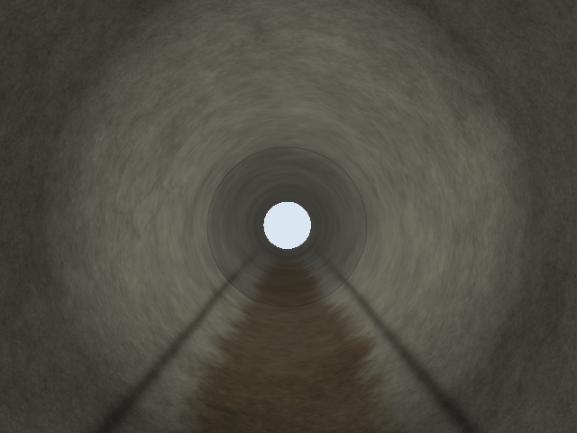
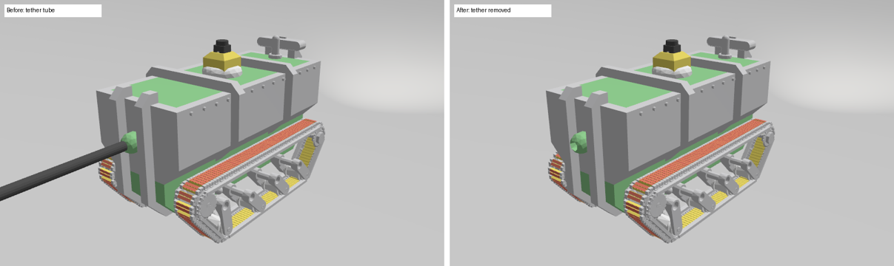

# 900 mm pipes, sewer test network, pipe texture, tether, Nav2 goals

> **Update (network round):** `./agos start` now replaces the terminals in
> "How to run" below, and the default world is the larger network. See
> `NETWORK_NAV_EXPLORE.md`.

This round of changes covers your five requests. The robot is unchanged in
size; everything else is sized around it.

| # | You asked | What changed | Files |
|---|---|---|---|
| 1 | Enlarge the pipe to the 900 mm sewer size | Your CAD pipe is scaled up 2.25x so its 400 mm bore is now 900 mm. Same shape, 15.5 m long, 1.37 m bends | `tools/make_pipe_mesh.py`, `meshes/agos_pipe.*`, `worlds/agos_pipe.sdf` |
| 2 | A larger 900 mm test network, loaded by default | New world `agos_sewer.sdf`: four manholes joined in a 47 m loop, plus a 10 m dead-end branch. It is now the default | `worlds/agos_sewer.sdf` (new), `meshes/agos_sewer_*` (new), `launch/sim.launch.py` |
| 3 | Make the inside of the pipe easier to see | Concrete texture with pipe joints every 2.4 m, sediment along the bottom, a dried flow line, stains and cracks; a bump map; separate texture for the manholes | `tools/make_pipe_texture.py` (new), `materials/textures/*` (new), both worlds |
| 4 | Remove the tether | The 25 mm tube that ran 0.69 m out of the back is left out of the robot meshes. The fitting it plugs into stays | `tools/convert_robot_stl.py`, `meshes/agos_dark.stl` |
| 5 | Nav2 goals don't go where you click | Nav2's stock settings assume a small round robot in a room that is already mapped, and odometry had two errors (skidding tracks, pipe bends). All fixed; goals round corners, into the dead end and back now arrive within 0.3 m | `config/nav2_agos.yaml` (new), `config/ekf.yaml` (new), `launch/slam_nav.launch.py`, `launch/sim.launch.py`, `config/bridge.yaml`, `urdf/agos_urdf.xacro`, `urdf/agos_tracks.xacro`, `urdf/agos_sensors.xacro`, `package.xml` |



---

## 1. Your pipe at 900 mm (`worlds/agos_pipe.sdf`)

Scaling the whole CAD pipe by 900 / 400 = 2.25 keeps its shape exactly. The
bends become 1.37 m in radius (1.5 times the bore), which is the standard
long-radius bend for sewer pipe. The wall stays 100 mm.

The mesh now rests on the ground in the file itself (z = 0 is the ground, the
bottom inside the pipe is at z = 0.1), so the world places it at the origin.
The robot still spawns in the middle of the longest straight, facing +x.

Use it with `world:=agos_pipe.sdf`.

## 2. The sewer test network (`worlds/agos_sewer.sdf`, the default)

```
   D ===== S-bend ===== C          A (0, 0)     B (16, 0)
   |                    |          C (16, 11)   D (0, 12.85)
   |                    |
   A ================== B ==.      branch off B: 3 m east, a 90 deg bend,
                            ||     5 m south, capped (dead end)
                            ==
```

- **Pipes:** 900 mm bore, 100 mm wall, 57 m in all. The longest straight is
  13.6 m. The S-bend is two 45° bends; the branch has one 90° bend. All bends
  are 1.35 m in radius.
- **Manholes:** 2.4 x 2.4 m inside, 1.8 m high, with a 700 mm access shaft in
  the roof (it lets in a patch of daylight, a useful landmark). They are the
  only places the robot can turn round.
- **Floor in the manholes:** flat, 24 mm above the bottom of the pipe, which
  is where the tracks touch the curved pipe. In front of each pipe opening it
  rises at the sides to meet the pipe, like real manhole benching. Without
  this the tracks hit a 30 mm lip at every opening, and a robot arriving 10 cm
  off-centre hit a 10 cm one and stuck (this happened in testing).
- **Spawn:** the middle of manhole A, facing B (+x).

The loop lets RTAB-Map close a loop when you drive all the way round. The dead
end tests reversing out.



## 3. Texture

`tools/make_pipe_texture.py` draws the textures with numpy (no image files
from elsewhere). Down the pipe one image covers 19.2 m, and each 2.4 m section
in it has its own shade, stains and cracks. Each pipe run starts at a
different point in the image, so the walls don't repeat every few metres. That
matters for RTAB-Map: identical-looking walls can fool its loop closure.

What you see inside the pipe:

- dark joint lines every 2.4 m, which give a sense of distance and speed;
- a brown sediment band along the bottom and a dried flow line above it;
- stains running down the sides, hairline cracks, and patches of biofilm;
- a bump map that makes the concrete grain and joints catch the headlight.

The pipe meshes are now `.obj` files, because STL can't carry texture
coordinates. Gazebo draws the `.obj` and collides with the `.stl`; both are
made by `make_pipe_mesh.py`.



## 4. Tether removed

In `AGOS V1.stl` the tether is a single 25 mm tube, 711 mm long, of which
685 mm sticks out behind the body. `convert_robot_stl.py` now leaves out any
piece that reaches more than 100 mm behind the body; the tether is the only
one. The green fitting where it leaves the robot stays. To bring it back, run
the converter with `--keep-tether`.

Only `agos_dark.stl` changed (1,252 to 1,188 triangles); the other five meshes
are identical to before. The tether never had a collision shape, so this
changes the look, RViz and the camera's view of the robot, not the physics.



## 5. Why Nav2 goals went to the wrong place, and the fixes

### 5a. Nav2's stock settings assume a small round robot in a mapped room

`slam_nav.launch.py` used Nav2's stock `nav2_params.yaml` with only the
footprint changed. Three stock settings work against AGOS in a pipe:

- **Obstacle padding (inflation) of 0.7 m.** The pipe is 0.9 m wide where the
  LiDAR sees it, so the padding covered the whole pipe. In the old 600 mm pipe
  the LiDAR saw only 0.46 m of width, so the robot's 0.38 m body was always
  "in collision" and Nav2 could not plan or follow a path at all.
- **The controller prefers driving forwards** (MPPI's `PreferForwardCritic`)
  and **turns to match the goal arrow** at the end (`GoalAngleCritic`, with a
  0.25 rad heading tolerance). In a pipe the robot cannot turn round: its
  tracks climb the curved wall. So a goal behind it, or an arrow pointing the
  "wrong" way, made it try to turn on the spot and get stuck.
- **The spin recovery.** When Nav2 gets stuck it tries spinning on the spot,
  which in a pipe makes things worse.

The fix is a short file of overrides, `config/nav2_agos.yaml`, that
`slam_nav.launch.py` merges over the stock file (so you can read exactly what
differs):

| Setting | Stock | AGOS | Why |
|---|---|---|---|
| inflation radius | 0.7 m | 0.45 m | fits a 0.9 m pipe |
| footprint | 0.22 m circle | 0.71 x 0.38 m rectangle | the real robot |
| reverse speed (`vx_min`) | -0.35 m/s | -0.3 m/s | reverse as fast as forwards |
| top speed / turn rate | 0.5 m/s, 1.9 rad/s | 0.3 m/s, 1.0 rad/s | pipe inspection speed |
| `PreferForwardCritic`, `GoalAngleCritic` | on | off | don't insist on turning round |
| `PathAngleCritic` mode | 0 (forwards) | 1 (either way) | follow the path forwards or backwards |
| goal heading tolerance | 0.25 rad | any | the robot may not be able to turn |
| `CostCritic` footprint check | circle | rectangle | the robot is long and the pipe is narrow |
| keepout / speed filters | `KEEPOUT_ZONE_ENABLED` placeholder | off | the placeholder is only filled in by Nav2's full bringup launch |
| global costmap size | the size of the SLAM map | 50 x 50 m, follows the robot | see below |
| path planner | NavFn | Smac 2D | see below |
| `bt_navigator` server timeout | 20 ms | 200 ms | with Gazebo, SLAM and RViz on one computer, a goal failed with "Behavior Tree action client timed out waiting" |

Two more problems showed up when sending goals in the sewer network:

- **Goals in pipes the robot hasn't seen yet were refused.** The global
  costmap was exactly the size of the map RTAB-Map had built so far, so a
  click beyond it failed with "Goal Coordinates ... was outside bounds". In a
  sewer that is most clicks: you can see in Gazebo where the pipe goes, but
  the map doesn't reach it yet. The global costmap is now a 50 x 50 m window
  centred on the robot, which covers the whole network from anywhere in it.
  Nav2 may plan through the unseen parts until the LiDAR sees them.
- **NavFn couldn't plan down an unmapped pipe.** Looking down a pipe, the
  LiDAR beams that go straight down the middle hit nothing, so the middle of
  the pipe ahead stays "unknown" while the walls are mapped. NavFn failed
  there with "Failed to create a plan from potential when a legal potential
  was found". Smac 2D, Nav2's A* planner, plans through it.

The launch file also makes a copy of Nav2's two behaviour trees without the
Spin recovery (clear costmaps, wait and back up remain).

**What this means when you click a goal:** the robot drives there forwards or
backwards, whichever needs no turning round, and stops facing whichever way it
arrived. The direction of the goal arrow is ignored. To turn the robot round,
send it into a manhole first.

### 5b. Track odometry over-counted every turn by 30 %

A tracked robot skids sideways when it turns, so it turns less than its track
speeds say. In Gazebo, AGOS turned 0.77 times as far as the diff-drive maths
predicts, and `/odom` reported the full predicted turn. After a 90° turn,
odometry thought the robot faced 117°, and every metre after that was drawn
on the map in the wrong direction. Nav2 then steered to correct an error that
didn't exist.

Fix: DiffDrive now uses an effective track separation of 0.373 m (the real
0.287 m divided by 0.77, `skid_factor` in `agos_urdf.xacro`). A commanded turn
rate is now the turn rate the robot really makes, and `/odom` reports it
correctly. On flat ground the ratio is now 1.00 (it was 0.77).

### 5c. Pipe bends threw odometry off by 60° or more

Even with 5b, the S-bend alone added 63° to the track odometry's heading
error, and after driving through your CAD pipe it was 138° wrong. In a bend
the curved wall steers the robot as much as the tracks do, so the tracks
can't tell how far it turned.

Fix: an EKF (`robot_localization`, `config/ekf.yaml`) now produces the
robot's odometry. It takes the forward speed from the tracks and the turn rate
from the IMU's gyro, and publishes `/odom` and the `odom -> base_footprint`
transform. The raw track odometry moved to `/wheel/odom`. The IMU now has
realistic noise so the EKF has something real to filter. Run with `ekf:=false`
to go back to raw track odometry. In testing (below) the EKF's odometry
stayed within 5.3° of the truth through every bend and manhole turn.

New dependency: `sudo apt install ros-lyrical-robot-localization`
(also listed in `package.xml`, so `rosdep install` finds it).

---

## How it was tested (here)

ROS 2 Lyrical and RTAB-Map can't be installed where I work, so the Nav2 runs
used ROS 2 Kilted with Gazebo 9, with slam_toolbox standing in for RTAB-Map.
Everything else was this package as it is: the robot, the worlds, the
bridge, the EKF, and Nav2 started by the same code as `slam_nav.launch.py`.
The physics and picture checks used Gazebo 10, your version. Positions below
are Gazebo's true positions, not the robot's estimate.

**Driving (a simple path follower, no Nav2):**

- Sewer network: the full loop A, B, C, S-bend, D, A, 56.48 of 56.50 m,
  without sticking at any manhole opening.
- Your CAD pipe at 900 mm: end to end, 10.28 of 10.30 m.
- Turning on the spot: the robot turned 0.77 times what was commanded before
  the skid factor, 1.00 times after.
- Track odometry alone: 10° wrong after the first manhole turn, 63° more from
  the S-bend, 135° wrong by the end of the loop; 138° wrong through your CAD
  pipe.

**Nav2 goals in the sewer network**, one after another, starting with no map
at manhole A:

| Goal | What the robot did | Result |
|---|---|---|
| (16, 6): round the corner into pipe B-C, 22 m, none of it mapped | drove forwards, turned in manhole B | reached, 0.26 m off |
| the dead end, past the 90° bend | reversed out of B-C, turned while reversing in B, reversed into the branch and round its bend | reached, 0.23 m off |
| back to A, 22 m | drove forwards out of the branch and along A-B | reached, 0.26 m off |
| (13, 11) in pipe C-D | reversed along A-B, turned in B, reversed up B-C, turned in C | reached, 0.05 m off |
| manhole D, through the S-bend, 14 m | reversed through the S-bend | reached, 0.13 m off |

Earlier runs also reached goals 8 m ahead (0.14 m off) and 4 m behind (0.37 m
off; it reversed without turning). Before the fixes in 5a, the corner goal
failed: once with "outside bounds", once with NavFn's "Failed to create a
plan", and once stuck at the entrance to manhole B.

Over this whole run, about 100 m with six manhole turns, the 90° bend and the
S-bend, the EKF's odometry (before any SLAM correction) stayed within 0.32 m
and 5.3° of the truth. Raw track odometry was 135° out after one loop.

The test computer ran the simulation at about a fifth of real time, which is
how the Nav2 timeout problem above showed up.

## How to run

```bash
sudo apt install ros-lyrical-robot-localization     # once
cd "<your path>/agos_gazebo_rviz_test/practice_agos"
rm -rf build install log                            # the mesh files changed type
colcon build --symlink-install

# every terminal:
source /opt/ros/lyrical/setup.bash
source install/setup.bash

# Terminal 1: Gazebo + RViz, sewer network (default)
ros2 launch agos_sim sim.launch.py
#   your pipe at 900 mm:  ros2 launch agos_sim sim.launch.py world:=agos_pipe.sdf
# Terminal 2: RTAB-Map + Nav2
ros2 launch agos_sim slam_nav.launch.py
```

In RViz, click **Nav2 Goal** and click a point inside a pipe or manhole. The
arrow's direction doesn't matter. Goals in parts of the map RTAB-Map hasn't
seen yet are allowed, but the plan there is a guess until the robot sees it.

## Things to know

1. **Turning round needs a manhole.** In a 900 mm pipe the robot drives
   forwards or backwards only. Nav2 now does that on its own.
2. **Leaving a manhole straight helps.** The benching guides the robot into
   the pipe, but it should still arrive roughly in line with it. Nav2's path
   goes through the middle of the opening, so this is mostly a teleop concern.
3. **The camera's far clip is 8 m,** so in long straights the far end shows as
   sky colour. That is the camera setting in `agos_sensors.xacro`, not a hole.
4. **Nav2 prefers pipes it has already mapped.** Unmapped space is allowed
   but costs more, so given a choice it takes the known way round. In testing
   it chose 30 m of mapped pipe over 26 m of unmapped pipe. To send it a new
   way, click a goal partway along that way first.
5. **The global costmap in RViz is now a 50 m square** that moves with the
   robot. The grey around the map is unknown space Nav2 may plan through.
6. **`STL_INTEGRATION.md` sections 1, 6 and 8** and its "Things to know" 1 to 5
   describe the earlier 600 mm pipe. This file replaces them.
