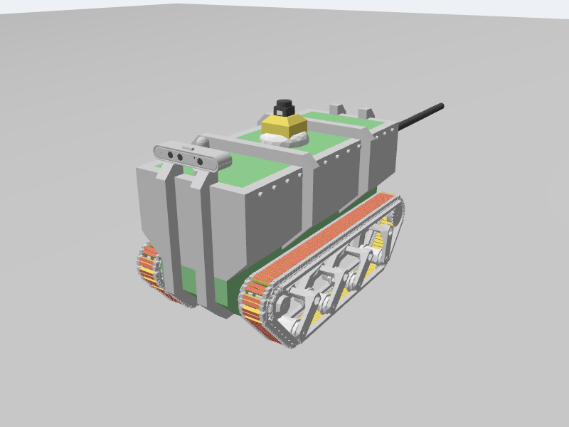
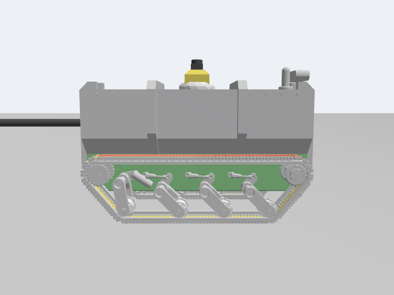

# Robot and pipe STL integration (practice_agos/agos_sim)

> **Update (network round):** `./agos start` now replaces the terminals in
> "How to run" below, and the default world is the larger network. See
> `NETWORK_NAV_EXPLORE.md`.

> **Update:** the pipes are now 900 mm, the default world is a larger sewer
> network, the tether is gone and Nav2 is fixed for pipes. See
> [PIPES_AND_NAV2.md](PIPES_AND_NAV2.md). Sections 1, 6 and 8 and "Things to
> know" 1 to 5 below describe the earlier 600 mm pipe.

Your two CAD exports from `Designs/STL` are now in the simulation:

- **`AGOS V1.stl`** is the robot you see in Gazebo and RViz, in its CAD colours.
  The sensors and track contacts sit where they are in the CAD.
- **`PipeDesign_AGOS.stl`** is the new default world, `worlds/agos_pipe.sdf`,
  with one change: the bore is **600 mm instead of 400 mm**, because the robot
  does not fit through 400 mm (see section 1).

Unlike the RTAB-Map fixes, this was run here in **Gazebo Jetty (gz-sim 10.5)**,
the Gazebo that ROS 2 Lyrical uses. The world loads, the robot spawns and sits
level in the pipe, the camera, depth and LiDAR publish, and a test controller
drove it from the spawn point through every bend to the open end. ROS itself
(the bridge, RViz, RTAB-Map, Nav2) was not run here, so please do the checks at
the end after rebuilding.

This is how the robot renders in Gazebo (screenshots from the test run):




## Outline

| # | Change | Why | Files |
|---|---|---|---|
| 1 | Pipe rebuilt from its CAD path with a 600 mm bore | The CAD pipe's bore is 400 mm. The robot is 381 mm wide and 476 mm tall, so it cannot fit | `tools/make_pipe_mesh.py` (new), `meshes/agos_pipe.stl` (new) |
| 2 | Robot CAD split by colour and simplified into 6 meshes | 10.1 million triangles (505 MB) is far too heavy for Gazebo and RViz | `tools/convert_robot_stl.py` (new), `meshes/agos_*.stl` (new) |
| 3 | URDF rebuilt around the CAD: frames, visuals, collision shapes, colours | The old model was a 600 x 420 x 320 mm box sketch of the robot | `urdf/agos_urdf.xacro`, `urdf/agos_materials.xacro` |
| 4 | Tracks: 6 driven wheels per side at the CAD roller positions | Old wheels were 160 mm across at the wrong spacing, so the robot sat at the wrong height and width | `urdf/agos_tracks.xacro` |
| 5 | Camera, LiDAR and IMU moved to their CAD positions, plus a front headlight | Sensors must see from where they really are. Inside a pipe there is almost no light | `urdf/agos_sensors.xacro` |
| 6 | New world with the pipe, now the default | Somewhere to drive the real robot | `worlds/agos_pipe.sdf` (new) |
| 7 | Launch: Gazebo can find the meshes; spawn pose and headless arguments | Without the resource path the meshes don't load. The robot must spawn inside the pipe | `launch/sim.launch.py` |
| 8 | Nav2 uses the robot's real rectangle | A 0.37 m circle is wider than the pipe | `launch/slam_nav.launch.py` |
| 9 | Meshes are installed by `colcon build` | RViz and Gazebo look for them in `install/` | `setup.py` |

---

## 1. The pipe: same path, 600 mm bore

**What your CAD pipe is.** `PipeDesign_AGOS.stl` is a Fusion export in mm. It
has a 600 mm outside diameter with a 100 mm wall that goes **inward**, so the
inside (bore) is **400 mm**. The centreline lies flat on the ground and is
6.88 m long: straights of 0.61 m and 1.22 m (2 ft and 4 ft) joined by bends with
a 0.61 m radius (two 90° bends and one 180° U-bend). Both ends are open.

**Why it had to change.** The robot is **381 mm wide** across the tracks and
**476 mm tall** to the top of the LiDAR (406 mm to the top of the lid). It is
taller and wider than a 400 mm bore. The proposal's 450 mm mockup pipe is too
small as well. Standing on the curved floor, the robot needs a bore of about
540 mm just to fit (worked out from the CAD dimensions). **600 mm** leaves room to get round the bends, and it
matches your CAD's outside diameter.

**What I did.** `tools/make_pipe_mesh.py` rebuilds the pipe from the exact same
centreline: same straights, same bends, same open ends. You choose the bore and
wall thickness. I checked it against your file: with a 400 mm bore it matches
your STL to within 1.3 mm everywhere, and the volumes agree to 0.05 %. The
default output is a 600 mm bore with a 100 mm wall: 34,048 triangles,
watertight, in metres.

```bash
python3 agos_sim/tools/make_pipe_mesh.py                          # 600 mm bore, 100 mm wall
python3 agos_sim/tools/make_pipe_mesh.py --bore 0.55 --wall 0.02   # any other size
```

If you change the size, also update two numbers:
- the pipe `<pose>` z in `worlds/agos_pipe.sdf`, which must be bore/2 + wall so
  the pipe rests on the ground;
- `spawn_z` in `sim.launch.py` (see section 7).

**Layout** (seen from above, the robot spawns in the middle of the 1.22 m
straight, facing +x):

```
ahead : 0.61 m straight -> 180° U-bend to the right -> 0.61 m straight
        -> 90° bend to the left -> 0.61 m straight -> open end   (4.70 m in all)
behind: 0.61 m straight -> 90° bend -> 0.61 m straight -> open end
```

## 2. The robot meshes

**What your CAD robot is.** `AGOS V1.stl` is a binary STL from Fusion, in mm,
with the robot facing +y. It has 10,114,564 triangles (505 MB). Every triangle
also stores a colour (16 colours in all). The grey body alone is 9.9 million
triangles in 3,212 separate pieces: track links, pins, bolts, plates,
sprockets, swing arms and so on. Most of the triangles are in small pieces:
the 1,888 pieces between 1 and 3 cm across (mostly track link parts) hold 7.9
million of them.

**Why it needed work.**
- **Size.** Gazebo and RViz load and redraw every triangle, so 10 million of
  them make both very slow to start and slow to draw.
- **Colour.** STL colours are not a standard part of the format, and RViz
  ignores them. The URDF gives each mesh one colour, so the robot needs one
  mesh per colour.
- **Direction and units.** ROS uses metres with +x forward. The CAD uses mm
  with +y forward.

**What I did.** `tools/convert_robot_stl.py` does these steps:
1. **Split by colour.** The triangles are grouped by their stored colour into
   six parts.
2. **Simplify each piece on its own.**
   - Small pieces (under 30 mm across) and thin ones (under 1.5 mm) become a
     plain box. Round ones become an 8-sided cylinder (pins) or disc (lenses).
     That covers the track links, pins and red tread strips.
   - Larger pieces are simplified only as far as they keep their shape: size
     within 0.5 mm (or 1 %), surface area within 6 %, volume within 5 %.
   - Long chain and rail pieces that can't be simplified without breaking
     become a box. Bolt-like pieces whose threads hold most of their triangles
     become a 16-sided cylinder.
3. **Rotate and scale.** Each part is turned 90° so +x is forward, converted to
   metres and written to `meshes/agos_<part>.stl`.

I first simplified each whole colour at once. That spent the triangle budget
badly: sprocket teeth vanished, the swing arms lost their shape, the track
links became jagged slivers and the red tread strips disappeared. Working piece
by piece keeps all of them, as the screenshots above show.

The six parts are:

| Mesh | What it is | Colour in the URDF | Triangles |
|---|---|---|---|
| `agos_body.stl` | Hull, frame, track chains, sprockets, swing arms | grey | 198,035 |
| `agos_treads.stl` | Red strips on the track links | red | 7,104 |
| `agos_accents.stl` | Yellow track blocks and LiDAR mount | yellow | 7,220 |
| `agos_light.stl` | Road wheels, LiDAR base and other white parts | light grey | 2,366 |
| `agos_green.stl` | Lid panels, belly and the fitting where the tube leaves the back | green | 168 |
| `agos_dark.stl` | LiDAR head, camera lenses, the tube out the back | near black | 1,252 |

Together they are about 216,000 triangles (11 MB), 2 % of the original. Any
graphics card handles that easily. Each part's outline is within 4 mm of the
CAD (most within 0.1 mm).

The CAD origin, the middle of the robot, becomes `base_link`. It is 0.178 m
above the bottom of the tracks.

If the CAD changes, re-run the script. It needs `numpy`, `scipy` and
`fast-simplification`, about 3 GB of RAM, and takes about 3 minutes:

```bash
python3 agos_sim/tools/convert_robot_stl.py "/path/to/AGOS V1.stl"
python3 agos_sim/tools/convert_robot_stl.py "/path/to/AGOS V1.stl" --list-colours
```

If you recolour parts in Fusion, `--list-colours` shows which colours are not
assigned to a part. Add them to `PARTS` at the top of the script.

## 3. URDF: frames, look and collision

**Frames.**

```
base_footprint                  ground, under the middle of the robot
└─ base_link = chassis_link     +0.178 m (the CAD origin)
   ├─ 12 track wheels           (section 4)
   ├─ camera_link               (0.331, 0, 0.2465) -> camera_optical_frame
   ├─ lidar_link                (0, 0, 0.287)
   └─ imu_link                  (0, 0, 0.01)
```

Every number is in metres in the `base_link` frame, measured from the CAD. The
old model put `base_link` at axle height (0.08 m). Now it is the CAD origin, so
the meshes need no offsets and anything you measure in Fusion (in mm, rotated
to x-forward) can go straight into the URDF.

**Visuals.** `chassis_link` shows the six meshes in their CAD colours, which are
defined in `agos_materials.xacro`. The old box visuals are gone (belly, silver
box, lid plate, roll-cage arches, whip pole, LiDAR pedestal), along with the
camera, LiDAR and IMU boxes and the black track shapes. The CAD already
contains all of them.

**Collision.** Physics does not use the meshes. Mesh-on-mesh contact is slow and
unstable, so the body uses four simple shapes that follow its cross-section:

| Shape | Size (m) | Covers |
|---|---|---|
| Box | 0.66 x 0.28 x 0.149 | Lid and upper hull (0.08 to 0.229 above `base_link`) |
| Box | 0.62 x 0.22 x 0.18 | Lower hull and belly between the tracks |
| Box | 0.099 x 0.165 x 0.074 | Camera housing on the front of the lid |
| Cylinder | r 0.04, 0.095 tall | LiDAR and its pedestal |

The upper box is 0.28 m wide, not the full 0.381 m, because the lid is
narrower than the tracks below it. My first version used the full width. Its
top corners hit the curved pipe wall in the U-bend, and the robot rolled
onto its side. With boxes that follow the real shape, it drives through.

**Mass.** The chassis is still 15 kg and each wheel 0.25 kg, about 18 kg in
total. These are placeholders. Put in your real masses when you have them.

## 4. Tracks

**Before.** There were three wheels per side, 0.16 m across, 0.36 m apart, plus
black boxes and cylinders drawn as the track.

**Now.** Each track is six collision-only wheels (38.5 mm radius, 42 mm wide,
centred 0.1436 m either side), driven together:

| Wheel | x (m) | Bottom above ground | Grip (mu) | Purpose |
|---|---|---|---|---|
| `idler_front` | 0.29 | 0.09 m | 0.8 | Raised front of the track, for climbing lips and pipe walls |
| `road_1` | 0.203 | 0 | 0.05 | CAD roller. Slides sideways so the robot can turn |
| `road_2` | 0.076 | 0 | 1.0 | CAD roller. Carries the grip |
| `road_3` | -0.051 | 0 | 1.0 | CAD roller. Carries the grip |
| `road_4` | -0.206 | 0 | 0.05 | CAD roller. Slides sideways so the robot can turn |
| `idler_rear` | -0.29 | 0.09 m | 0.8 | Raised back of the track |

This keeps the trick your old file used: grippy middle wheels and slippery
end wheels let a skid-steer robot turn without fighting itself. The DiffDrive
plugin drives all 12 joints, with `wheel_separation` 0.287 m (track centre to
track centre) and `wheel_radius` 0.0385 m. Topics and frames are unchanged:
`/cmd_vel`, `/odom`, `odom -> base_footprint`.

The tracks you see (chains, links, red strips) are part of the CAD mesh. They
don't move when the robot drives.

## 5. Sensors

| Sensor | Where (from the CAD) | Height above ground |
|---|---|---|
| Orbbec RGB-D camera | Centre of the lens panel, on its mount at the front of the lid | 0.42 m |
| LD06 LiDAR | Scan plane inside the LiDAR head on top of the lid | 0.465 m |
| IMU | Robot centre | 0.19 m |

- **LiDAR height.** The scan plane is 1 cm above the top of the camera, so the
  camera can't block any beams. Checked: all 360 beams return, and none hit the
  robot itself.
- **Sensor settings.** Rates, resolution, field of view and ranges are the
  same as in your file. Only the positions changed.
- **Headlight.** Inside a pipe there is very little light, so the robot carries
  a spot light (`agos_headlight`) at the camera, pointing forward. It stands in
  for the high-intensity front LED in the proposal. `camera_link` is kept as its
  own link in Gazebo (`preserveFixedJoint`) so the light stays at the camera.

## 6. The pipe world

`worlds/agos_pipe.sdf` has:
- the same systems as `agos_world.sdf` (physics, sensors with ogre2, IMU, user
  commands);
- a ground plane;
- the pipe as a static mesh, using the same mesh for its collision, with wall
  grip 0.8.

The pipe sits at z = 0.4 m (bore/2 + wall), so it rests on the ground. The world
origin is the middle of the longest straight. Ambient light is 0.5 (0.4 in
`agos_world.sdf`) so the inside of the pipe isn't black where the headlight
doesn't reach.

The old world still works: `world:=agos_world.sdf`.

## 7. Launch changes (`sim.launch.py`)

- **`GZ_SIM_RESOURCE_PATH`.** The world refers to the pipe as
  `model://agos_sim/meshes/agos_pipe.stl`. When Gazebo converts the URDF, its
  `package://agos_sim/meshes/...` paths become `model://agos_sim/...` too.
  Gazebo finds `model://agos_sim` only by searching the folders in
  `GZ_SIM_RESOURCE_PATH`. The launch file now adds your `install/agos_sim/share`
  folder to it. Without this, the robot and pipe are invisible and the pipe has
  no collision. RViz doesn't need it: it finds `package://` through the ROS
  package index.
- **New arguments.**

  | Argument | Default | Meaning |
  |---|---|---|
  | `world` | `agos_pipe.sdf` | Which world to load (was `agos_world.sdf`) |
  | `spawn_x`, `spawn_y`, `spawn_yaw` | `0.0` | Where the robot starts, facing which way |
  | `spawn_z` | `0.16` | Start height. The pipe floor under the tracks is at 0.149 m, so it drops 1 cm and settles |
  | `headless` | `false` | `true` runs Gazebo without its window (server only) |

  If you resize the pipe, set `spawn_z` to about wall + r - sqrt(r² - 0.165²)
  + 0.01, where r is half the bore. The 0.165 is half the distance between the
  outer edges of the tracks.

## 8. Nav2 footprint (`slam_nav.launch.py`)

After the RTAB-Map fixes, Nav2 used a round robot with a 0.37 m radius. That
circle is 0.74 m across, wider than the 0.6 m pipe, so Nav2 would treat every
pipe cell as a collision. The costmaps now use the real outline, a
0.712 x 0.382 m rectangle around `base_link`, set as `footprint` wherever the
stock file has a `robot_radius`. See caveat 2 for what this still means inside
the pipe.

## 9. Packaging (`setup.py`)

`meshes/*.stl` is now installed into `share/agos_sim/meshes`. RViz and Gazebo
load the meshes from there. The `tools/` scripts are not installed; run them
from the source folder.

---

## How it was tested (Gazebo Jetty 10.5, here)

- `gz sdf -k` reports both worlds valid. The URDF converts cleanly (16 collision
  shapes), and the camera keeps its sensor and headlight.
- The robot's look was checked with three cameras in an empty world (the
  screenshots at the top). All six meshes load with their colours.
- The robot spawns and settles level, with its tracks on the curved floor.
- LiDAR: 360 of 360 beams return. Walls are 0.212 m away on both sides, with
  no hits on the robot itself.
- RGB camera: the pipe is lit by the headlight. The very first frame can be
  black, which is normal. Depth reads 0.19 to 1.19 m from the spawn point.
- Driving: a simple path follower kept the robot on the pipe's centreline at
  0.1 m/s. It went from the spawn point through the U-bend, the straight and the
  90° bend to the open end (4.63 of 4.70 m). The robot rolled up to about 20°
  where its tracks climbed the curved wall in the bends, and pitched 11° when
  its front dropped off the open end.

## How to run

```bash
cd <your path>/agos_gazebo_rviz_test/practice_agos
colcon build --symlink-install
source install/setup.bash

# Terminal 1: Gazebo + RViz with the pipe (default)
ros2 launch agos_sim sim.launch.py
#   old room world:   ros2 launch agos_sim sim.launch.py world:=agos_world.sdf
# Terminal 2: RTAB-Map (see caveat 2 before using Nav2 inside the pipe)
ros2 launch agos_sim slam_nav.launch.py nav2:=false
# Terminal 3: drive
ros2 run teleop_twist_keyboard teleop_twist_keyboard
```

Quick checks:

```bash
ros2 topic hz /scan                  # about 10 Hz
ros2 topic hz /camera/image_raw      # about 15 Hz
ros2 run tf2_ros tf2_echo base_footprint lidar_link   # z = 0.465
```

**Driving in the pipe.** Go slowly (0.1 to 0.2 m/s) and steer gently: the
U-bend ahead of the spawn turns right, and the bend after it turns left. In
RViz, set Fixed Frame to `odom` if RTAB-Map isn't running.

## Things to know

1. **The robot can't turn on the spot inside the pipe.** Its footprint's
   diagonal is 0.81 m, longer than the 0.6 m bore. It can only go forwards or
   backwards, steering through the bends.
2. **Nav2 inside the pipe will probably refuse to plan** (expected, not tested
   here). At the LiDAR's height the pipe is only 0.42 m wide, and the robot is
   0.38 m wide. The costmap will see walls about 2 cm from each side of the
   footprint, inside its inflation radius, along the whole pipe. Inside the pipe,
   driving along the known centreline (as the test did) is a better fit than
   Nav2's planner. Nav2 still makes sense in the open room world.
3. **RTAB-Map in pipes.** In this short pipe a bend is almost always in LiDAR
   view, which gives scan matching something to lock on to. In a long straight
   pipe the scan is just two parallel lines and can't show how far the robot
   moved, so RTAB-Map falls back on wheel odometry there. The pipe is also one
   flat colour, which gives the camera few features for loop closure. A
   textured pipe (weld seams, rust patches, markers) would help both.
4. **The tube out the back** (0.69 m long, part of `agos_dark.stl`) is visual
   only. In bends you'll see it pass through the pipe wall. It doesn't affect
   driving.
5. **Skid-steer odometry** still over-reports turning, as noted in the RTAB-Map
   fixes.
6. **Gazebo warning** `//sensor/gz_frame_id is deprecated`. Jetty prints this
   when it loads the sensors. It is harmless: the frame ids still come through.
7. **`AGOS V1.stl.gz`** in your `Designs/STL` folder is a compressed copy I made
   so the 505 MB file could be uploaded here. You can delete it; the original
   `AGOS V1.stl` is untouched.
8. **`urdf/tracked_robot.urdf.xacro`** is unchanged and still not used by the
   launch files.
